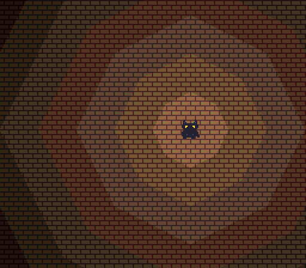

# Cyclorama SDK

The development kit for the **Avenell Cyclorama**, a 16-bit home console from 1987 that never
existed. The console is fiction. The hardware is real: it has a complete specification, a
deterministic reference emulator, an assembler, a compiler for its own language, a sound driver
and a conformance suite, and you can write cartridges for it today.



*[Lantern Test](roms/lantern-test/lantern-test.asm), frame 72, the D-pad held right and A held
for a wider light: a real frame of the emulator in this repository, rendered with
`npm run frame` (the test re-renders it; [provenance](docs/guide/images/images.json)).*

## The machine

The Cyclorama's signature is the **light field**: four positioned lights, computed in hardware
for every pixel, choose which of eight shade planes each pixel's colour comes from. Games light
their scenes instead of drawing darkness by hand.

| Part | What it is |
|---|---|
| CPU | **Tally**, 16-bit, 8 general registers, 64 KiB address space, about 3.58 MHz |
| Video | **Barndoor**, 256 × 224, two 8 × 8 tile layers of 3 bits per pixel, 64 sprites (16 per line), 512 colours of 12 bits in 8 shade planes, 4 lights |
| Audio | **Cue**, three tone voices (pulse, triangle, sawtooth, 32-step wavetable) and one noise voice, hardware envelopes, mono at about 47.9 kHz |
| Memory | 16 KiB work RAM, 32 KiB video RAM, banked cartridge ROM from 32 KiB to 1 MiB, optional 8 KiB battery-backed cartridge RAM |
| Input | two controllers: D-pad, A, B, C and START |

Every number above is normative: the [hardware and programmer's manual](docs/manual/index.html)
(HED-0041) defines the machine, and the emulator implements exactly that. The manual is written
in the voice of a 1987 engineering document for licensed developers; that frame is fiction, the
technical content is not.

## What is in the box

| | |
|---|---|
| **Specification** | The manual [HED-0041](docs/manual/index.html), the [spec notes](docs/spec-notes.md) that settle what the manual left open, the [SCRIM language specification](docs/scrim-spec.md), and the hardware facts as data ([`canon/canon-public.json`](canon/canon-public.json)) |
| **Emulator** | [`src/machine/`](src/machine/): cycle-counted, deterministic (the same input always gives the same machine state, bit for bit), with save states. Runs in Node and in the browser |
| **CYASM** | The assembler and disassembler ([`src/asm/`](src/asm/)) |
| **SCRIM** | The Cyclorama's structured, compiled language and its compiler ([`src/scrim/`](src/scrim/)), which emits native Tally code through CYASM |
| **SDK runtime** | The Cue Sound Driver ([`roms/lib/`](roms/lib/)) and the SCRIM runtime, which may be compiled into your ROMs without attribution |
| **Asset tools** | Text formats for tiles and sprites (`.art`) and for music (`.song`), converted at build time |
| **Reference player** | One self-contained web page per cartridge ([`src/web/`](src/web/)): keyboard, gamepad, sound |
| **Conformance suite** | 15 ROMs in [`tests/conformance/`](tests/conformance/) that define the machine executably; each reports pass or the number of its first failing check |
| **Demo cartridges** | [Lantern Test and its SCRIM twin](roms/), the [Sound Test](roms/sound-test/), and the SLICE test cartridge, a complete small game with a completion replay |
| **Tests** | Over 600 of them, all in [`npm run verify`](docs/guide/getting-started.md#run-the-gate) |

## Five minutes

You need [Node.js 24.21.0](.nvmrc) and git.

```sh
git clone https://github.com/rick-learns/cyclorama-sdk.git
cd cyclorama-sdk
npm ci
npx playwright install chromium
npm run player -- roms/lantern-test/lantern-test.asm .tmp/lantern-test.html
```

Open `.tmp/lantern-test.html` in a browser, click to start, and walk the cat with the arrow keys
(Z is A). Then:

- [Getting started](docs/guide/getting-started.md): build every ROM, run the conformance suite
  and the whole gate.
- [Tutorial 1](docs/guide/tutorial-1-cyasm.md): your first cartridge, in assembly: a sprite on
  the screen, then moved with the pad.
- [Tutorial 2](docs/guide/tutorial-2-scrim.md): a small complete game in SCRIM, with the light
  field, music and sound effects.
- [Embedding the emulator](docs/guide/embedding.md), [debugging](docs/guide/debugger.md), the
  [command-line reference](docs/guide/cli.md), the [SDK library reference](docs/guide/sdk-library.md)
  and the rest: [all guides](docs/guide/README.md).

## Licences and the name

The code is [Apache-2.0](LICENSE); the specification and documentation are
[CC BY 4.0](LICENSES/CC-BY-4.0.txt). ROMs you build are yours. The SDK runtime that gets compiled
into them (the Cue Sound Driver, the SCRIM runtime) is Apache-2.0 WITH LLVM-exception, so a ROM
needs no attribution for it. The example programs are plain Apache-2.0: if your ROM reuses their
code, [LICENSING.md](LICENSING.md#sdk-runtime-code) says what that means. LICENSING.md also has
the path-by-path map.

"Avenell", "Cyclorama" and their logos are trademarks and are not licensed by any of the above.
You may say your game or tool is "for the Cyclorama" in plain text; you may not call it official
or use the logos. [TRADEMARKS.md](TRADEMARKS.md) says exactly what is fine.

## Contributing

Issues and pull requests are welcome: see [CONTRIBUTING.md](CONTRIBUTING.md) (tests first,
commits signed off under the Developer Certificate of Origin), the
[code of conduct](CODE_OF_CONDUCT.md) and, for anything security-related, [SECURITY.md](SECURITY.md).
What changed in each release: [CHANGELOG.md](CHANGELOG.md).
