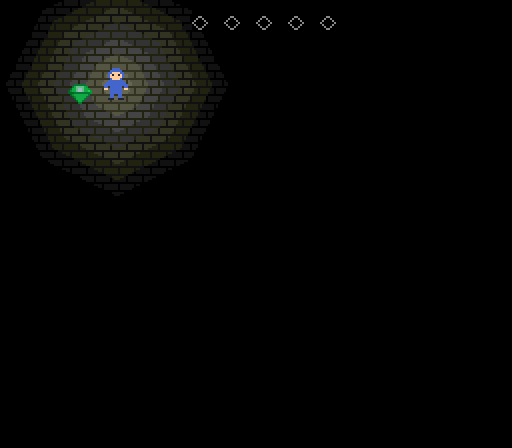

# Tutorial 2: gems in the dark (SCRIM)

You will write a small, complete game in SCRIM, the development kit's compiled language: a dark
room, a player who carries the only light, five gems that show only when the light reaches them,
music from power-on, a sound for every gem and a jingle when the fifth is found. The whole game
is one program in [`examples/tutorial-2/`](../../examples/tutorial-2/), with its pictures and
music beside it; this page walks through it from top to bottom and quotes every line of it
(a test checks that it does, and another test checks that the game does what the page says).
Type the excerpts in the order they appear and you have the whole program; its picture and music
files, `tutorial-2.art` and `tutorial-2.song`, are quoted only in part, so copy them from the
folder. Keep the program two folders below the repository root (as in `examples/<name>/`), or
change the `LINK` path to the sound driver to match.

Do [Tutorial 1](tutorial-1-cyasm.md) first: it explains colour RAM, tiles, sprites, DMA, the
pad and VBLANK in assembly, and this page builds on it. The
[SCRIM language specification](../scrim-spec.md) is the reference for the language, the
[hardware manual](../manual/index.html) for the machine.

## Build it and play it

<!-- run -->
```sh
npm run scrim -- examples/tutorial-2/tutorial-2.scr -o .tmp/tutorial-2.rom
npm run player -- examples/tutorial-2/tutorial-2.scr .tmp/tutorial-2.html
```

The first command compiles the program to a 32 KiB cartridge image (add `--report` to see the
size and a cycle estimate of each procedure). The second builds the same program into one
self-contained web page with the reference player: open `.tmp/tutorial-2.html` in a browser.
The arrow keys are the D-pad. Walk around to find the gems.



## The header, the constants and the variables

<!-- sample: examples/tutorial-2/tutorial-2.scr lines 7-8 -->
```scrim
PROGRAM Tutorial2;
HEADER title = "TUTORIAL 2", dev = $0000, date = $19870918, version = $0100;
```

A SCRIM program starts with its name and the cartridge header, the same fields as CYASM's
`.header`. The compiler writes the vector table, the header and a short start-up routine for
you: it sets the stack pointer to C000, turns the display off, zeroes every module variable,
hides all 64 sprites and then runs the program's main body.

<!-- sample: examples/tutorial-2/tutorial-2.scr lines 10-21 -->
```scrim
CONST
  PAD_UP = 1; PAD_DOWN = 2; PAD_LEFT = 4; PAD_RIGHT = 8;
  PLAY = 1; WON = 2;                     -- the values of gstate
  SPEED = 2;                             -- pixels a frame
  MAX_X = 240; MAX_Y = 208;              -- 256 - 16 and 224 - 16: the player stays on screen
  GEMS = 5;
  MAP = $6000;                           -- BG0's map (the reset value of BG0MAP)
  HUD = MAP + (64 + 12) * 2;             -- map row 1, column 12: the first gem icon
  UNLIT = $8000;                         -- map entry or sprite flag: ignore the light field
  SIZE16 = 1; HIDE = 2;                  -- OAM word +6
  GEM_PALETTE = 1 SHL 10;                -- OAM word +4: sprite palette 1
  T_FLOOR = 1; T_SLOT = 2; T_ICON = 3; T_PLAYER = 4; T_GEM = 8;   -- tile numbers
```

Constants are names for numbers, worked out by the compiler (`--` starts a comment). A tile map
is 64 × 32 entries of one word each, so entry (column 12, row 1) of the map at 6000 is at
6000 + (1 × 64 + 12) × 2. The tile numbers say where `loadTiles` (below) puts each picture: the player and
the gems are 16 × 16 sprites, four tiles each (4-7 and 8-11).

<!-- sample: examples/tutorial-2/tutorial-2.scr lines 23-30 -->
```scrim
VAR gstate: WORD;                        -- the first VAR, so it is at 8000
    got: WORD;                           -- gems collected, 0-5
    px, py: WORD;                        -- the player's top-left corner
    taken: ARRAY [5] OF BYTE;            -- 1 once gem i is collected
    SND_RAM: ARRAY [136] OF WORD;        -- the Cue Sound Driver's 272 bytes

DATA gemX: ARRAY [5] OF WORD = (32, 208, 48, 192, 112);
DATA gemY: ARRAY [5] OF WORD = (40, 56, 176, 168, 192);
```

Module `VAR`s live in work RAM from 8000 upward in the order they are declared, so `gstate`,
the game's state word, is always at 8000, where a debugger (or a test) can read it. `DATA` is
read-only and stays in the cartridge ROM: here the five gem positions. `SND_RAM` is the sound
driver's working memory. The driver finds it by that name, and declaring it as an
`ARRAY OF WORD` keeps it on the even address the driver needs; start-up zeroes it with the
other variables.

## Linking the sound driver and the assets

<!-- sample: examples/tutorial-2/tutorial-2.scr lines 32-42 -->
```scrim
ASSET "tutorial-2.art";                  -- tiles and colours
ASSET "tutorial-2.song";                 -- SONG_theme, SONG_win, SFX_gem
LINK "../../roms/lib/cuesound.inc";      -- the Cue Sound Driver
EXTERN DATA FLOOR, SLOT, ICON: ARRAY [24] OF BYTE;   -- one 8 x 8 tile each
            PLAYER, GEM: ARRAY [96] OF BYTE;         -- 16 x 16: four tiles each
            ROOM_COLOURS, PLAYER_COLOURS, GEM_COLOURS: ARRAY [8] OF WORD;
EXTERN CONST SONG_theme, SONG_win, SFX_gem: WORD;
EXTERN PROC SndInit;
EXTERN PROC SndPlaySong(song: WORD);
EXTERN PROC SndSfx(sfx: WORD);
EXTERN PROC SndTick;
```

`ASSET` converts a text asset when the ROM is built and links the result into the cartridge;
`LINK` links a CYASM source file as it is, here the kit's Cue Sound Driver
([roms/lib/README.md](../../roms/lib/README.md)). Paths are relative to the SCRIM file.
Neither makes names known to SCRIM by itself: each `EXTERN` gives a symbol that the linked
assembly defines a SCRIM type. `EXTERN DATA` is a ROM label, read like `DATA`; `EXTERN CONST`
is a number known when the ROM is linked (the address of a song or an effect); `EXTERN PROC` is
an assembly routine that follows SCRIM's calling convention. The rules are in section 10 of the
[language specification](../scrim-spec.md).

The pictures are in `tutorial-2.art`. A `@palette` block lists up to seven colours as `$RGB`
for colours 1-7 (colour 0 is 000 unless the block gives a `0=$RGB` entry), and each `@tiles` or `@sprite16` block becomes planar tile
data under its name:

<!-- sample: examples/tutorial-2/tutorial-2.art lines 13-14 -->
```text
@palette GEM_COLOURS       ; sprite palette 1: 1 edge, 2 body, 3 facet, 4 glint
$0A4 $2E6 $8FB $CFF
```

<!-- sample: examples/tutorial-2/tutorial-2.art lines 64-80 -->
```text
@sprite16 GEM
................
................
.....111111.....
....12333321....
...1223443221...
..122234432221..
..111111111111..
...1222222221...
....12222221....
.....122221.....
......1221......
.......11.......
................
................
................
................
```

## Colours for every shade

<!-- sample: examples/tutorial-2/tutorial-2.scr lines 44-64 -->
```scrim
-- Colour col ($RGB) at brightness s/7, rounded (manual 5.9.5): 0 is black, 7 the colour as drawn.
FUNC dim(col, s: WORD): WORD;
BEGIN
  RETURN (((col SHR 8) AND 15) * s + 3) / 7 SHL 8
      OR (((col SHR 4) AND 15) * s + 3) / 7 SHL 4
      OR ((col AND 15) * s + 3) / 7
END;

-- Shade plane s (CRAM s x 64 onwards) holds each colour at brightness s/7: BG palette 0,
-- and sprite palettes 0 and 1 (CRAM palettes 4 and 5).
PROC loadColours;
VAR s, c: WORD;
BEGIN
  FOR s := 0 TO 7 DO
    FOR c := 0 TO 7 DO
      CRAMADDR := s * 64 + c;       CRAMDATA := dim(ROOM_COLOURS[c], s);
      CRAMADDR := s * 64 + 32 + c;  CRAMDATA := dim(PLAYER_COLOURS[c], s);
      CRAMADDR := s * 64 + 40 + c;  CRAMDATA := dim(GEM_COLOURS[c], s)
    END
  END
END;
```

This is where the light field starts. With it on, the video chip gives every lit pixel a shade
from 0 to 7, and draws it in the colour at CRAM entry shade × 64 + palette × 8 + pixel: each
shade has its own 64 colours (a *shade plane*). The program decides what the planes hold. Here
plane *s* holds every colour at *s*/7 of its brightness, rounded: each channel becomes
(channel × *s* + 3) / 7, so shade 0 is black and shade 7 is the colour as drawn. That is the ramp
the manual recommends ([5.9.5](../manual/index.html#vid-shade-planes)); a full channel of 15 goes
0, 2, 4, 6, 9, 11, 13, 15 through the planes. `dim` scales the red, green and blue digits
separately; `*`, `/`, `SHL`, `SHR` and `AND` share one precedence level and are applied left to
right, and `/` calls a small division routine the compiler links in. Only the three palettes
the game uses are loaded; the main body loads them while the display is still off, so taking a
few frames over it shows nothing half-done.

## Tiles and the room

<!-- sample: examples/tutorial-2/tutorial-2.scr lines 66-82 -->
```scrim
PROC loadTiles;                          -- tile n goes to VRAM n x 24; 12 words a tile
BEGIN
  VRAM_COPY(T_FLOOR * 24, @FLOOR, 12);
  VRAM_COPY(T_SLOT * 24, @SLOT, 12);
  VRAM_COPY(T_ICON * 24, @ICON, 12);
  VRAM_COPY(T_PLAYER * 24, @PLAYER, 48);
  VRAM_COPY(T_GEM * 24, @GEM, 48)
END;

PROC drawRoom;                           -- floor everywhere, then five empty slots
VAR i: WORD;
BEGIN
  VADDR := MAP;
  FOR i := 1 TO 64 * 32 DO VDATA := T_FLOOR END;
  VADDR := HUD;
  FOR i := 1 TO GEMS DO VDATA := T_SLOT OR UNLIT; VDATA := T_FLOOR END
END;
```

`VRAM_COPY(address, source, words)` is the DMA copy of Tutorial 1 as one runtime call; `@`
takes an address. Every I/O register is predeclared in SCRIM under its manual name (the three
whose names are keywords get a `_PORT` suffix), so
`VADDR := MAP` is a store to the VADDR port and each `VDATA := …` writes one map entry and moves
VADDR on by 2. `drawRoom` fills BG0's whole map with the floor tile, then writes the five gem
slots on row 1, two map entries apart (a slot, then a floor tile, then the next slot). A map entry is the tile number with flags in its top bits:
bit 15 (`UNLIT`) makes the slots ignore the light field and use the `FIXED` shade, 7 after
reset, so the row of slots stays readable in the dark. The floor tiles are lit.

## Sprites and the light

<!-- sample: examples/tutorial-2/tutorial-2.scr lines 84-95 -->
```scrim
PROC drawSprites;
VAR i: WORD;
BEGIN
  OAMADDR := 0;                          -- sprite 0: the player, unlit, so always seen
  OAMDATA := py; OAMDATA := px; OAMDATA := T_PLAYER OR UNLIT; OAMDATA := SIZE16;
  FOR i := 0 TO GEMS - 1 DO              -- sprites 1-5: the gems, lit, so dark outside the light
    OAMDATA := gemY[i]; OAMDATA := gemX[i]; OAMDATA := T_GEM OR GEM_PALETTE;
    IF taken[i] = 0 THEN OAMDATA := SIZE16 ELSE OAMDATA := HIDE END
  END;
  L0X := px + 8;                         -- light 0 at the player's centre
  L0Y := py + 8
END;
```

Each sprite is four OAM words: Y, X, tile with palette and flags, then size and hide. The
player is sprite 0 with the unlit flag (bit 15 of word +4), so it is drawn at shade 7 wherever
it is. The gems are sprites 1-5 in sprite palette 1, *without* the unlit flag: like the floor,
they take their shade from the light field, and a gem at shade 0 is black on a black floor.
A collected gem gets the hide bit. Where sprites overlap, the lower number wins, so the player
is drawn in front of a gem.

Light 0 is put at the player's centre. Light positions are screen coordinates, and the chip
reads the light registers at the start of every line, so the position is written once per
frame while nothing is being drawn ("Start-up and the frame loop" says when).

## Input

<!-- sample: examples/tutorial-2/tutorial-2.scr lines 97-103 -->
```scrim
PROC move(pad: WORD);
BEGIN
  IF ((pad AND PAD_LEFT) <> 0) AND (px > 0) THEN px := px - SPEED END;
  IF ((pad AND PAD_RIGHT) <> 0) AND (px < MAX_X) THEN px := px + SPEED END;
  IF ((pad AND PAD_UP) <> 0) AND (py > 0) THEN py := py - SPEED END;
  IF ((pad AND PAD_DOWN) <> 0) AND (py < MAX_Y) THEN py := py + SPEED END
END;
```

The main loop (at the end of the program) passes `PAD1`, controller 1's buttons, sampled by the chip at the start of VBLANK.
On integers `AND` is bitwise, so `pad AND PAD_LEFT` picks one button; between conditions it is
the logical AND and stops early. The player moves 2 pixels a frame. It starts at 120, 104 and
always moves in steps of 2, so it can only reach even positions, and the checks stop it at 0
and at 240 (x) or 208 (y): a 16 × 16 sprite at 240 fills the last column of the 256-pixel
screen. Holding Left and Right together moves it back and forth in the same frame, so it stays
put, except at the left edge: there Left is refused and Right moves it on to x = 2, where it then
stays. Up and Down together do the same at the top.

## Collisions

<!-- sample: examples/tutorial-2/tutorial-2.scr lines 105-109 -->
```scrim
-- The player touches gem i when their 16 x 16 boxes overlap by more than 4 pixels each way.
FUNC touching(i: WORD): BOOL;
BEGIN
  RETURN (px < gemX[i] + 12) AND (gemX[i] < px + 12) AND (py < gemY[i] + 12) AND (gemY[i] < py + 12)
END;
```

Two boxes of the same size overlap when each starts before the other ends. Using 12 instead
of 16 asks for more than 4 pixels of overlap each way, so brushing past a gem's empty corner
does not count.

## Winning

<!-- sample: examples/tutorial-2/tutorial-2.scr lines 111-116 -->
```scrim
PROC win;
BEGIN
  gstate := WON;
  SndPlaySong(SONG_win);                 -- the jingle replaces the theme
  L0F := $25                             -- octagon, falloff 5: the light fills the room
END;
```

After the fifth gem the state becomes WON, and the loop stops calling `move` and `collect`, so
the pad does nothing more. Starting a song stops the one playing, so the jingle replaces the
theme; it has no loop point, so it plays once. Falloff 5 makes the light lose one shade every 32
pixels instead of 8: the light now reaches up to 223 pixels from the player, and is dark only
from 224 on, which is nearly the whole room. `collect`, next, calls `win` after the fifth gem.

## Collecting a gem, with a sound

<!-- sample: examples/tutorial-2/tutorial-2.scr lines 118-131 -->
```scrim
PROC collect;
VAR i: WORD;
BEGIN
  FOR i := 0 TO GEMS - 1 DO
    IF (taken[i] = 0) AND touching(i) THEN
      taken[i] := 1;
      VADDR := HUD + got * 4;            -- the next slot (slots are two map entries apart)
      VDATA := T_ICON OR UNLIT;
      got := got + 1;
      SndSfx(SFX_gem);
      IF got = GEMS THEN win END
    END
  END
END;
```

A gem is collected once: `taken` remembers it, and `drawSprites`, which runs next, hides it.
The next empty slot at the top becomes a gem icon (the video chip's memory may be written at
any time), and `SndSfx` starts the effect. An effect names its own voice; the driver plays it
there while the music goes on, and if the song also used that voice the music would keep its
place and come back when the effect ends. This song leaves voice 2 free for effects.

## Start-up and the frame loop

<!-- sample: examples/tutorial-2/tutorial-2.scr lines 133-162 -->
```scrim
INTERRUPT PROC onVblank;
BEGIN
  SndTick;                               -- the driver plays one frame of music and effects
  IF_PORT := 1                           -- acknowledge VBLANK
END;

VECTOR VBLANK := onVblank;

BEGIN
  gstate := PLAY;
  px := 120; py := 104;
  loadColours;
  loadTiles;
  drawRoom;
  drawSprites;
  AMBIENT := 0;                          -- no light but the player's
  L0I := 7;                              -- light 0: intensity 7,
  L0F := $23;                            -- octagon (shape 2, bits 5-4), falloff 3
  SndInit;
  SndPlaySong(SONG_theme);
  VCTRL := 1 OR 2 OR 8 OR 16;            -- display, BG0, sprites, light field
  IF_PORT := 1;                          -- forget a VBLANK that is already pending
  IE := 1;                               -- enable the VBLANK interrupt
  ASM EI END;
  WHILE TRUE DO
    WAIT;                                -- sleep until VBLANK has run onVblank
    IF gstate = PLAY THEN move(PAD1); collect END;
    drawSprites
  END
END.
```

The main body is the `BEGIN … END.` at the end of the file. It sets the variables, loads
colours, tiles and the map, and sets up the light:

- `AMBIENT` is added to the shade of every lit pixel; 0 leaves the room black outside the light.
- `L0I` is light 0's intensity and `L0F` its falloff (bits 2-0) and shape (bits 5-4, 2 =
  octagon, the closest to a round pool). At a pixel whose octagon distance from the light is
  *d*, the light adds 7 − (*d* >> 3), never less than 0: 7 at the centre, one shade less every
  8 pixels, nothing from 56 pixels out. One light of intensity 7 and no ambient keep every sum
  within 0-7, so the chip's shade adder never wraps round.

`SndInit` resets the driver and `SndPlaySong(SONG_theme)` starts the theme; its first row
plays at the first `SndTick`. `VCTRL` then turns on the display, BG0, sprites and the light
field. The last three lines before the loop enable the VBLANK interrupt as in Tutorial 1:
`IF_PORT` is SCRIM's name for the `IF` register (IF is a keyword), and there is no EI
statement, so a one-line `ASM` block runs the instruction.

An `INTERRUPT PROC` saves and restores every register and returns with RTI; `VECTOR` puts it in
the vector table, and it must acknowledge its own interrupt. `onVblank` runs once per frame,
when the picture ends, and calls `SndTick` first so the music keeps an even pace.

The loop is the game. `WAIT` sleeps (the `WAI` instruction) until the VBLANK interrupt has run;
then the program reads the pad, moves, checks for gems and rewrites the sprites and the light.
All of it, with `SndTick`, takes at most about 2,200 CPU cycles on the tutorial test's
playthrough that collects all five gems (`npm run budget -- examples/tutorial-2/tutorial-2.scr`
measures 600 frames with no input instead, a lower figure), well inside the roughly 8,700 cycles of vertical blank (38 of the frame's 262 lines), so
the picture never changes while it is being drawn.

## The music

The songs and the effect are in `tutorial-2.song`, a text format like a tracker's
([roms/lib/README.md](../../roms/lib/README.md) section 2). Instruments set a waveform and a
volume envelope (start volume, then down one step every *n* ticks of 15.6 ms):

`wave` picks the waveform (here a 25 % pulse and a triangle), `env 11 down 3` starts at volume 11
and goes down one step every 3 ticks, and `vibrato 8 20 delay 14` wobbles the pitch (depth 8,
speed 20) after the note has sounded for 14 frames:

<!-- sample: examples/tutorial-2/tutorial-2.song lines 9-16 -->
```text
instrument lead
  wave pulse25
  env 11 down 3
  vibrato 8 20 delay 14

instrument bass
  wave triangle
  env 14 down 4
```

A pattern is one voice's notes, one row per token; `:n` holds the note for n rows in all, `off`
keys the note off, and `|` is a bar line for the reader that the converter ignores. The
song plays one pattern per voice on each `order` line, at `speed` frames per row, and `loop`
marks where it starts again:

<!-- sample: examples/tutorial-2/tutorial-2.song lines 41-48 -->
```text
song theme
  speed 7
  voices 0 1
  loop
  order m1 bAm
  order m2 bG
  order m3 bF
  order m4 bE
```

<!-- sample: examples/tutorial-2/tutorial-2.song lines 23-24 -->
```text
pattern m1 inst lead
  A-4:2 C-5:2 E-5:2 D-5:2 | C-5:3 B-4:1 A-4:4
```

The effect is a short pattern of its own, on the voice it names:

<!-- sample: examples/tutorial-2/tutorial-2.song lines 62-63 -->
```text
sfx gem voice 2 speed 2 inst glint
  B-5 E-6 G#6 B-6:6
```

The build turns this file into data and the symbols `SONG_theme`, `SONG_win` and `SFX_gem`,
which the program declared with `EXTERN CONST`. The driver's `SndTick` must stay under 3,000
cycles, 5 % of a frame; the tutorial's test measures about 1,200 at most for this music.

## What to try next

- Add a second light, a lamp on the wall that is always on: light 1 at a fixed place. Keep
  AMBIENT plus the intensities of the lights that can reach one pixel at 7 or less, or the
  bright part of the overlap wraps round to dark (manual 5.9.4).
- Give the room a timer and make the music faster as it runs out:
  `EXTERN PROC SndTempo(rate: WORD);` and the driver's tempo section in
  [roms/lib/README.md](../../roms/lib/README.md).
- For a game with a title screen, lives and a game-over screen, read
  [`roms/slice-test/slice-test.scr`](../../roms/slice-test/slice-test.scr).
